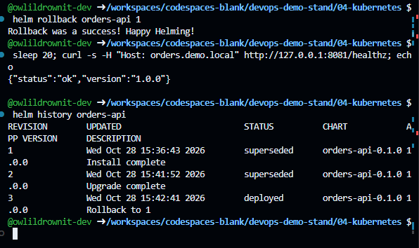
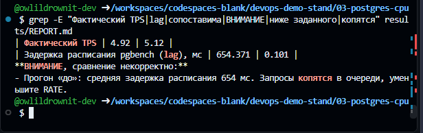
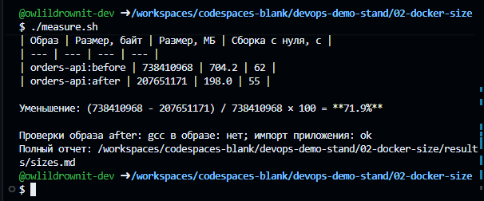
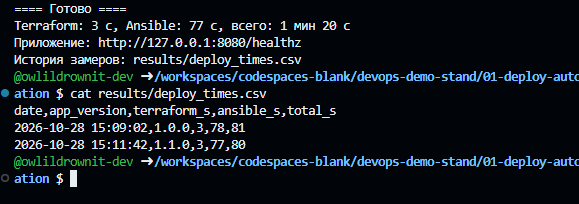

# orders-platform

A hands-on DevOps project built around a small order service (`app/`, Flask + PostgreSQL):
infrastructure as code, automated deployment, Docker image and database query optimization,
Kubernetes deployment, and network troubleshooting.

> All data is synthetic, and all measurements were taken in a test environment (GitHub Codespaces).

## Repository layout

| Directory | Contents |
| --- | --- |
| [`app/`](app/) | The `orders-api` service: Flask, gunicorn, psycopg2; multi-stage `Dockerfile` |
| [`infra/`](infra/) | Terraform (network, volume, PostgreSQL) and Ansible (migration, build, rolling update, nginx, smoke test) |
| [`k8s/`](k8s/) | kind cluster and the `orders-api` Helm chart: Deployment, Service, Ingress, HPA, PDB |
| [`benchmarks/image-size/`](benchmarks/image-size/) | Single-stage vs multi-stage image size comparison |
| [`benchmarks/postgres-cpu/`](benchmarks/postgres-cpu/) | PostgreSQL CPU usage before and after query optimization |
| [`docs/`](docs/) | Incident write-ups and screenshots |
| [`scripts/`](scripts/) | Tool installation and a Docker networking fix for Codespaces |

## Results (GitHub Codespaces, 2026-10-28)

The deployment, image size and PostgreSQL measurements were each taken twice; the raw output
of the second run is in the `results/` directories.

| Task | Run 1 | Run 2 | Summary |
| --- | --- | --- | --- |
| One-command deployment (`infra/deploy.sh`) | 81 s (infrastructure already in place) | 111 s from scratch, 28 s of it in Terraform | upgrade to 1.1.0: 80 s and 81 s |
| Image size, MiB | 704.2 → 198.0 | 704.2 → 198.0 | −71.9% |
| PostgreSQL CPU time over 120 s at 3 TPS | 118.30 s → 0.39 s | 125.09 s → 0.43 s | −99.7% |
| Kubernetes | HPA scaled 2 → 5 replicas; upgrade and `helm rollback` | | |

Calculations: (704.2 − 198.0) / 704.2 × 100 ≈ 71.9%; (125.09 − 0.43) / 125.09 × 100 ≈ 99.7%.

**HPA under load: 2 → 4 → 5 replicas**


**Helm: upgrade and rollback**



**PostgreSQL: a run with comparable load, and a run rejected by the validity check**




**Image sizes and deployment time**




## Getting started

**GitHub Codespaces:** Code → Codespaces → Create codespace. The tools are installed automatically
(`.devcontainer`, `scripts/setup-tools.sh`).

**Linux / WSL2 with Docker:** `bash scripts/setup-tools.sh`.

```bash
cd benchmarks/postgres-cpu && ./run.sh        # use RATE=3 ./run.sh if the report shows a WARNING
cd benchmarks/image-size && ./measure.sh
cd infra && ./deploy.sh                       # APP_VERSION=1.1.0 ./deploy.sh to upgrade
cd k8s && ./setup-cluster.sh                  # then ./load-test.sh and ./teardown.sh
```

## Incidents

- [Container-to-container timeouts in Codespaces (iptables-legacy)](docs/incidents/2026-10-28-container-traffic-timeouts.md)
