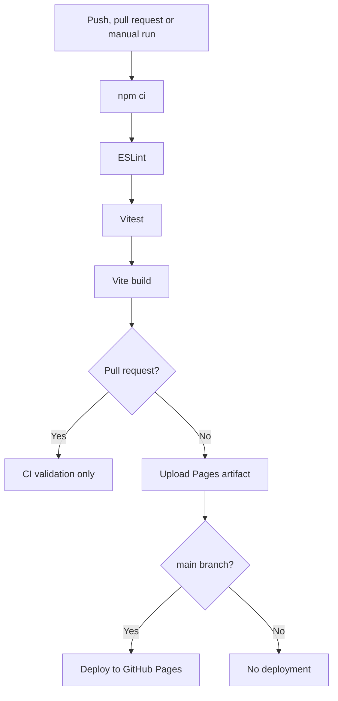

# CI/CD Demo - GitHub Actions, Vite and GitHub Pages

[](https://github.com/owlildrownit-dev/DevOps-Portfolio/actions/workflows/ci-demo.yml)

A practical demonstration of an automated CI/CD pipeline for a JavaScript application built with Vite.

The project focuses on automated quality checks, reproducible builds, deployment gating, and continuous delivery using GitHub Actions.

**[Live Application](https://owlildrownit-dev.github.io/DevOps-Portfolio/)** | **[CI/CD Workflow](../../.github/workflows/ci-demo.yml)** | **[Portfolio Repository](../../README.md)**

## Technology Stack

| Technology | Purpose |
| --- | --- |
| JavaScript | Application development |
| Node.js 24 | JavaScript runtime |
| Vite | Development server and application builds |
| ESLint | Static code analysis |
| Vitest | Automated unit testing |
| GitHub Actions | CI/CD automation |
| GitHub Pages | Static application hosting |

## CI/CD Architecture

The pipeline automates dependency installation, code validation, testing, building, and deployment.



The active pipeline is defined in:

[`../../.github/workflows/ci-demo.yml`](../../.github/workflows/ci-demo.yml)

### Continuous Integration

The `build` job executes the following steps:

1. Checks out the repository.
2. Configures Node.js 24.
3. Installs dependencies using `npm ci`.
4. Runs ESLint using `npm run lint`.
5. Executes Vitest tests using `npm run test`.
6. Builds the application using `npm run build`.

If linting, testing, or building fails, the job fails and deployment cannot proceed.

### Continuous Deployment

After a successful build on the `main` branch:

1. The workflow uploads the contents of `dist/` as a GitHub Pages artifact.
2. The `deploy` job starts after the `build` job succeeds.
3. GitHub Actions deploys the artifact to GitHub Pages.

The deployment job uses `needs: build`, so a failed build prevents deployment.

Deployment permissions are assigned to the deployment job:

- `pages: write`
- `id-token: write`

The build job uses read-only repository permissions.

### Workflow Triggers

| Event | Behavior |
| --- | --- |
| Push to `main` affecting the demo or its workflow | Run CI and deploy after successful validation |
| Pull request targeting `main` affecting the demo or its workflow | Run CI without deployment |
| Manual workflow dispatch on `main` | Run CI and deploy after successful validation |

Path filters prevent routine changes to unrelated projects from triggering this workflow.

The workflow also uses concurrency control to cancel superseded runs for the same Git reference.

## Local Development

### Requirements

- Node.js 24
- npm

### Installation

From the monorepository root:

```bash
cd devops/ci-cd-demo
npm ci
```

### Start Development Server

```bash
npm run dev
```

### Run Quality Checks

```bash
npm run lint
npm run test
```

### Build Application

```bash
npm run build
```

The generated static application is placed in `dist/`.

To preview the build locally:

```bash
npm run preview
```

## Deployment Configuration

The application uses the following Vite base path:

```javascript
base: '/DevOps-Portfolio/'
```

This ensures that application assets resolve correctly when hosted under the GitHub Pages repository path.

**Deployment URL:**

https://owlildrownit-dev.github.io/DevOps-Portfolio/

## CI Failure Handling

A historical test scenario was created to verify that a failed quality gate prevents deployment.

In the original repository, the `test/failing-test` branch contained an intentionally failing unit test.

The resulting workflow run demonstrated the expected behavior:

| Step | Result |
| --- | --- |
| Dependency installation | Passed |
| ESLint | Passed |
| Vitest | Failed |
| Application build | Skipped |
| GitHub Pages deployment | Skipped |

**[View the failed GitHub Actions run](https://github.com/owlildrownit-dev/demopipeline/actions/runs/37744929147)**

This confirms that the deployment job does not proceed when its required build job fails.

The historical test branch's commits were retained during the monorepository migration.

## Verified Deployment

The monorepository pipeline has successfully completed its build and deployment jobs.

**[View successful CI/CD run](https://github.com/owlildrownit-dev/DevOps-Portfolio/actions/runs/40843739885)**

The published application and its JavaScript, CSS, and favicon assets were verified to respond with HTTP 200 after deployment.

## Project Structure

```text
ci-cd-demo/
  src/
    assets/
    main.js
    sum.js
    sum.test.js
    style.css
  public/
    favicon.svg
    icons.svg
  index.html
  package.json
  package-lock.json
  eslint.config.js
  vite.config.js
  README.md
```

The CI/CD workflow is maintained in the monorepository root under `.github/workflows/`.

The original workflow remains inside this project's `.github/workflows/` directory as historical configuration.

## Monitoring and Limitations

The project demonstrates a CI/CD delivery process rather than a production application.

Current limitations:

- The unit test suite is intentionally small.
- Browser-based end-to-end tests are not included.
- An external uptime monitoring configuration is not included in the repository.
- CI verifies application quality checks and successful builds but does not guarantee the absence of runtime defects.

Possible extensions
