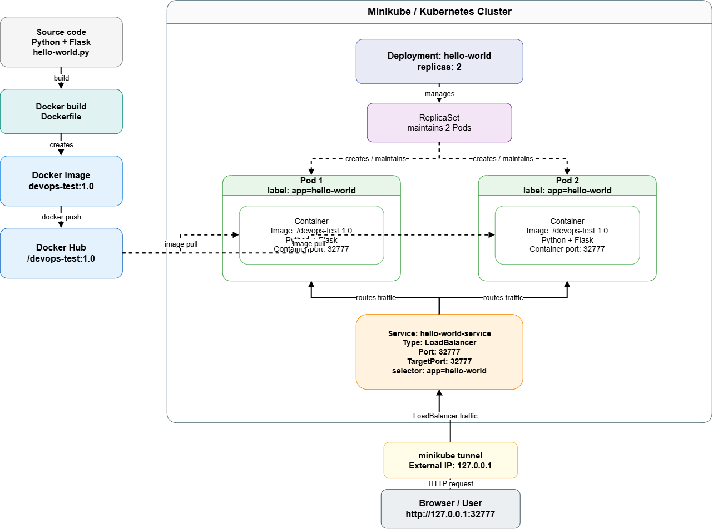

# Kubernetes Flask - Docker and Minikube Deployment

[](https://github.com/owlildrownit-dev/DevOps-Portfolio/actions/workflows/ci-kubernetes-flask.yml)

A containerized Python/Flask application demonstrating Docker image creation, Kubernetes deployment, service networking, local cluster operations, and automated image publishing.

The project uses a two-replica Kubernetes Deployment in Minikube and a GitHub Actions workflow for Docker builds and publication to GitHub Container Registry.

**[CI/CD Workflow](../../.github/workflows/ci-kubernetes-flask.yml)** | **[Portfolio Repository](../../README.md)**

## Technology Stack

| Technology | Purpose |
| --- | --- |
| Python 3.14 | Application runtime in Docker |
| Flask | HTTP application |
| Docker | Containerization |
| Kubernetes | Container orchestration |
| Minikube | Local Kubernetes cluster |
| kubectl | Kubernetes resource management |
| Headlamp | Kubernetes dashboard and inspection |
| GitHub Actions | Automated Docker builds |
| GHCR | Container image registry |

## Architecture



[Open architecture diagram source](docs/Scheme.drawio)

The Kubernetes environment consists of:

- A Deployment named `hello-world`.
- Two application replicas.
- Pods labeled `app: hello-world`.
- A Service named `hello-world-service`.
- A `LoadBalancer` Service exposing port `32777`.

The Service selects application Pods using the label `app: hello-world` and forwards traffic to their container port `32777`.

## Application

The application is a minimal Flask HTTP service.

It listens on:

```text
0.0.0.0:32777
```

The root endpoint `/` responds with:

```text
Hello, World!
```

The application implementation is located in [`hello-world/hello-world.py`](hello-world/hello-world.py).

## Local Docker Deployment

### Requirements

- Docker
- Git

From the monorepository root, navigate to the project:

```bash
cd devops/kubernetes-flask
```

### Build Image

```bash
docker build -t kubernetes-flask:local .
```

The Dockerfile uses `python:3.14-slim`, installs the Flask application's dependencies, and starts the application on port `32777`.

### Run Container

```bash
docker run --rm -p 32777:32777 kubernetes-flask:local
```

Open:

http://localhost:32777

Or verify the HTTP response:

```bash
curl http://localhost:32777/
```

Expected response:

```text
Hello, World!
```

## Kubernetes Deployment with Minikube

### Requirements

- Docker
- Minikube
- kubectl

### Start Local Cluster

```bash
minikube start --driver=docker
```

Verify the cluster:

```bash
minikube status
kubectl get nodes
```

### Deploy Application

Apply the Deployment manifest:

```bash
kubectl apply -f kube/deployment.yaml
```

Apply the Service manifest:

```bash
kubectl apply -f kube/service.yaml
```

Wait for the Deployment rollout:

```bash
kubectl rollout status deployment/hello-world
```

Inspect resources:

```bash
kubectl get deployments
kubectl get pods -l app=hello-world
kubectl get services
```

The Deployment specifies two replicas.

**Important:** The checked-in Kubernetes manifest currently references the historical Docker Hub image `owlildrownit/devops-test:1.0`. The GHCR publishing workflow does not automatically update or deploy this manifest. The referenced image must be accessible to the cluster.

### Access the Service

The application uses a Kubernetes Service of type `LoadBalancer`.

In a separate terminal, run:

```bash
minikube tunnel
```

Then inspect the assigned external address:

```bash
kubectl get service hello-world-service
```

Use the reported `EXTERNAL-IP` and port `32777` to access the application.

The tunnel must remain running while using this access method.

## CI/CD and Container Registry

The active GitHub Actions workflow is:

[`../../.github/workflows/ci-kubernetes-flask.yml`](../../.github/workflows/ci-kubernetes-flask.yml)

### Continuous Integration

When relevant project files or the workflow itself change, GitHub Actions:

1. Checks out the repository.
2. Builds the application Docker image.
3. Reports the build result.

Pull requests targeting `main` trigger Docker build validation without publishing an image.

### Container Image Publishing

For qualifying pushes to `main`, the workflow additionally:

1. Authenticates to GitHub Container Registry using `GITHUB_TOKEN`.
2. Tags the built Docker image.
3. Publishes the image to GHCR.

**Container image:**

```text
ghcr.io/owlildrownit-dev/devops-portfolio-kubernetes-flask
```

The workflow publishes two tags:

- `latest`
- `sha-<commit>`

Public pull access depends on the package's visibility settings in GitHub Packages.

**[View successful image publication](https://github.com/owlildrownit-dev/DevOps-Portfolio/actions/runs/40842770719)**

This CI/CD workflow builds and publishes images. It does not perform an automated Kubernetes deployment.

## Verification Evidence

The repository includes screenshots from the documented local deployment.

| Evidence | File |
| --- | --- |
| Minikube status | [View screenshot](screenshots/minikube_status.png) |
| Kubernetes nodes | [View screenshot](screenshots/kubernetes_nodes.png) |
| Deployment | [View screenshot](screenshots/deploy.png) |
| Kubernetes services | [View screenshot](screenshots/services.png) |
| Headlamp dashboard | [View screenshot](screenshots/HeadLamp.png) |
| Headlamp Deployment view | [View screenshot](screenshots/HeadLamp-deployment.png) |
| Docker Hub publication | [View screenshot](screenshots/docker-hub.png) |

## Project Structure

```text
kubernetes-flask/
  hello-world/
    hello-world.py
    requirements.txt
  kube/
    deployment.yaml
    service.yaml
  docs/
    Scheme.drawio
    Scheme.png
    answers.md
  screenshots/
  Dockerfile
  README.md
```

## Limitations and Future Improvements

This project demonstrates a local Kubernetes deployment and an automated Docker build-and-publish workflow.

Current limitations:

- The Kubernetes manifests reference the original Docker Hub image rather than the new GHCR package.
- Automated Kubernetes deployment is not configured.
- The Deployment does not define resource requests, resource limits, or health probes.
- The CI workflow validates Docker image builds but does not run application integration tests.

Possible improvements include:

- Updating the Kubernetes Deployment to use GHCR.
- Adding liveness and readiness probes.
- Defining resource requests and limits.
- Adding application smoke tests.
- Automating deployment to a test Kubernetes environment.

## Additional Documentation

- [Kubernetes manifests](kube/)
- [Architecture diagram](docs/Scheme.drawio)
- [Technical questions and answers](docs/answers.md)
- [Original project repository](https://github.com/owlildrownit-dev/DevOps-Test)
