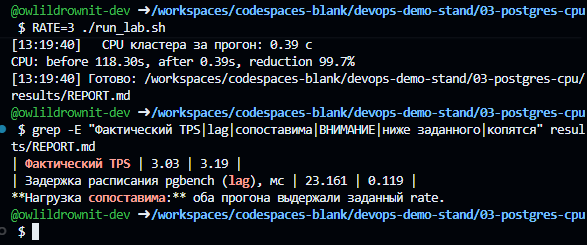

# Orders Platform - Infrastructure Automation and Kubernetes

[](https://github.com/owlildrownit-dev/DevOps-Portfolio/actions/workflows/ci-orders.yml)
[](https://github.com/owlildrownit-dev/DevOps-Portfolio/actions/workflows/ci-infrastructure.yml)

A hands-on DevOps project built around a Flask API backed by PostgreSQL.

The project demonstrates infrastructure provisioning, automated application deployment, Docker image optimization, database performance analysis, Kubernetes orchestration, and incident troubleshooting.

**[CI/CD Workflow](../../.github/workflows/ci-orders.yml)** | **[Infrastructure Validation](../../.github/workflows/ci-infrastructure.yml)** | **[Portfolio](../../README.md)**

> All benchmarks use synthetic data. The documented measurements were collected in a GitHub Codespaces test environment, not production.

## Technology Stack

| Area | Technologies |
| --- | --- |
| Application | Python, Flask, Gunicorn |
| Database | PostgreSQL, psycopg2 |
| Infrastructure as Code | Terraform |
| Configuration management | Ansible |
| Containers | Docker, multi-stage builds |
| Orchestration | Kubernetes, kind, Helm |
| Networking | Nginx, Traefik |
| CI/CD | GitHub Actions, GHCR |
| Performance analysis | pgbench, Docker image measurements |

## Architecture and Automation

The project contains two deployment approaches.

### Terraform and Ansible

The `infra/` directory provides infrastructure provisioning and deployment automation.

Terraform manages:

- Docker networking.
- Persistent database storage.
- PostgreSQL container resources.
- Configuration values consumed by Ansible.

Ansible manages:

- Database migrations.
- Application image builds.
- Application deployment and rolling updates.
- Nginx configuration.
- Smoke checks.

The deployment process is orchestrated through `infra/deploy.sh`.

The Terraform configuration uses local state. A shared production environment would require an appropriate remote backend and locking strategy.

[Infrastructure Documentation](infra/README.md)

### Kubernetes and Helm

The `k8s/` directory contains a local Kubernetes environment built with kind.

Components include:

- A kind cluster with one control-plane node and two workers.
- Traefik for Ingress routing.
- PostgreSQL.
- Application Deployment and Service.
- Horizontal Pod Autoscaler.
- PodDisruptionBudget.
- Health probes.
- Helm release management.

The application Helm chart supports rolling updates and rollback operations.

[Kubernetes Documentation](k8s/README.md)

## Repository Structure

| Directory | Purpose |
| --- | --- |
| [`app/`](app/) | Flask application, dependencies, Dockerfile |
| [`infra/`](infra/) | Terraform, Ansible, deployment automation |
| [`k8s/`](k8s/) | kind configuration, Kubernetes resources, Helm chart |
| [`benchmarks/image-size/`](benchmarks/image-size/) | Docker image size comparison |
| [`benchmarks/postgres-cpu/`](benchmarks/postgres-cpu/) | PostgreSQL CPU measurements |
| [`docs/`](docs/) | Incident reports and screenshots |
| [`scripts/`](scripts/) | Environment setup and troubleshooting scripts |

## CI/CD

The project uses GitHub Actions for automated Docker builds, container image publishing, and infrastructure configuration validation.

### Docker Build and GHCR Publishing

The active workflow is:

[`../../.github/workflows/ci-orders.yml`](../../.github/workflows/ci-orders.yml)

For qualifying pull requests, the workflow validates the Docker image build.

For qualifying pushes to `main`, it additionally authenticates to GitHub Container Registry and publishes the image.

**Container image:**

```text
ghcr.io/owlildrownit-dev/devops-portfolio-orders
```

Published tags:

- `latest`
- `sha-<commit>`

Public pull access depends on GitHub Packages visibility settings.

**[View successful Docker build and publication](https://github.com/owlildrownit-dev/DevOps-Portfolio/actions/runs/40842727862)**

### Infrastructure Validation

The infrastructure workflow validates Terraform configuration and the `orders-api` Helm chart.

| Check | Purpose |
| --- | --- |
| `terraform fmt -check` | Verify Terraform formatting |
| `terraform init -backend=false` | Initialize providers without a backend |
| `terraform validate` | Validate configuration consistency |
| `helm lint --strict` | Validate Helm chart structure |
| `helm template` | Render Kubernetes manifests |

These CI checks do not create infrastructure or deploy resources.

The workflow does not currently execute Ansible playbooks as part of CI.

**[View successful infrastructure validation](https://github.com/owlildrownit-dev/DevOps-Portfolio/actions/runs/40844547161)**

## Performance Results

The deployment, Docker image size, and PostgreSQL measurements were repeated twice in the documented test environment.

### Deployment Automation

| Measurement | Run 1 | Run 2 |
| --- | ---: | ---: |
| Deployment of version 1.0.0 | 81 s, infrastructure already present | 111 s from scratch |
| Upgrade to version 1.1.0 | 80 s | 81 s |

In the second initial deployment, Terraform accounted for 28 seconds of the total 111 seconds.

The deployment scripts record timings in CSV files.

[Deployment Results](infra/results/deploy_times.csv)

### Docker Image Optimization

A multi-stage Docker build reduced the application image size.

| Before | After | Reduction |
| ---: | ---: | ---: |
| 704.2 MiB | 198.0 MiB | 71.9% |

Calculation:

```text
(704.2 - 198.0) / 704.2 * 100 = 71.9%
```


### PostgreSQL CPU Optimization

CPU time was measured during synthetic 120-second tests at 3 transactions per second.

| Measurement | Before | After |
| --- | ---: | ---: |
| Run 1 | 118.30 s | 0.39 s |
| Run 2 | 125.09 s | 0.43 s |

Reduction for Run 2:

```text
(125.09 - 0.43) / 125.09 * 100 = 99.7%
```

These results apply to the documented benchmark workload and environment.



The benchmark also includes validity checks and records cases where the test conditions were not comparable.


### Kubernetes Autoscaling

During the documented load test, the Horizontal Pod Autoscaler increased application replicas:

```text
2 -> 4 -> 5
```

The configured maximum was five replicas.


### Helm Upgrade and Rollback

The project also demonstrates application upgrades and rollback through Helm.


## Getting Started

### Requirements

The complete environment uses:

- Linux or WSL2 with a compatible Ubuntu/Debian environment.
- Docker with a running daemon.
- Terraform.
- Ansible.
- kubectl.
- Helm.
- kind.

### Project Directory

From the monorepository root:

```bash
cd devops/orders-platform
```

### Environment Setup

The project includes a setup script for compatible Ubuntu/Debian environments:

```bash
bash scripts/setup-tools.sh
```

The script installs system packages and tools and performs Docker networking adjustments. Review it before running on a shared or production host.

### Docker Image Benchmark

```bash
(cd benchmarks/image-size && ./measure.sh)
```

### PostgreSQL Benchmark

```bash
(cd benchmarks/postgres-cpu && RATE=3 ./run.sh)
```

### Terraform and Ansible Deployment

```bash
(cd infra && ./deploy.sh)
```

This command provisions local Docker resources and deploys the application.

To upgrade the application version:

```bash
(cd infra && APP_VERSION=1.1.0 ./deploy.sh)
```

### Kubernetes Deployment

```bash
(cd k8s && ./setup-cluster.sh)
```

To generate traffic for autoscaling tests:

```bash
(cd k8s && ./load-test.sh)
```

To remove the local kind environment:

```bash
(cd k8s && ./teardown.sh)
```

Run each scenario separately according to its documented prerequisites.

## GitHub Codespaces

The original standalone project includes a development container configuration at `.devcontainer/devcontainer.json`.

After migration, that configuration is located under:

```text
devops/orders-platform/.devcontainer/devcontainer.json
```

GitHub Codespaces normally discovers development container configurations from supported locations at the repository root.

Therefore, the original automatic setup should not be assumed to work when creating a Codespace directly from the monorepository.

Options:

1. Use the [original standalone repository](https://github.com/owlildrownit-dev/stendemo) to reproduce its documented Codespaces setup.
2. Use a compatible Linux environment with Docker and install the tools manually.

Adapting the development container configuration to the monorepository layout is a separate improvement.

## Incident Documentation

The project includes a documented Docker networking incident encountered during testing in GitHub Codespaces.

**[Container-to-container traffic timeouts and iptables troubleshooting](docs/incidents/2026-10-28-container-traffic-timeouts.md)**

## Limitations

- Performance results were collected in a synthetic test environment.
- Terraform currently uses local state.
- The automated CI pipeline validates Terraform and Helm configurations but does not provision infrastructure.
- Docker images are published to GHCR, but automatic Kubernetes deployment from GHCR is not configured.
- The imported Codespaces configuration has not been adapted for automatic discovery at the monorepository root.

## Additional Documentation

- [Infrastructure automation](infra/README.md)
- [Kubernetes environment](k8s/README.md)
- [Docker image benchmarks](benchmarks/image-size/)
- [PostgreSQL benchmarks](benchmarks/postgres-cpu/)
- [Original repository](https://github.com/owlildrownit-dev/stendemo)
