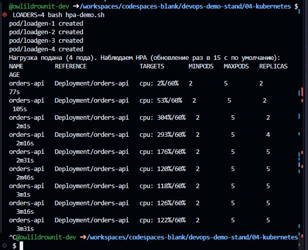
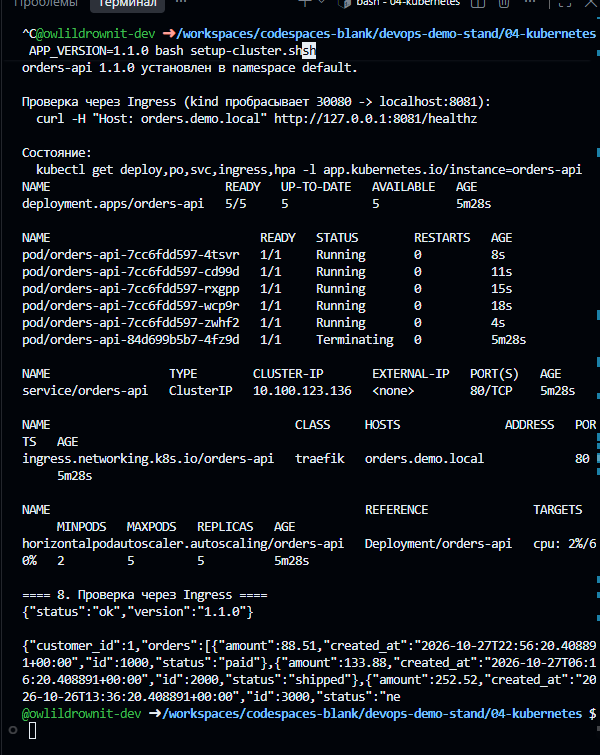

# k8s: kind + Helm

```bash
./setup-cluster.sh   # cluster, Traefik, metrics-server, PostgreSQL, orders-api Helm release
./load-test.sh       # traffic for exercising the HPA (stop with Ctrl+C)
./teardown.sh        # delete the cluster
```

Requirements: Docker, kind, kubectl, Helm 3 or 4.

## Request path

```
curl -H "Host: orders.demo.local" localhost:8081
  → host port 8081 → NodePort 30080 (extraPortMappings in kind-cluster.yaml)
  → Traefik → Ingress rule matched by host
  → orders-api Service (ClusterIP) → pods in the Ready state
  → container :8000 → postgres Service → StatefulSet postgres-0
```

## Components

| Topic | Where | Decision |
| --- | --- | --- |
| Cluster | `kind-cluster.yaml` | 1 control-plane node + 2 workers, explicit pod and service CIDRs |
| Ingress | `setup-cluster.sh` | Traefik with `ingressClassName: traefik`; ingress-nginx has been retired ([announcement](https://kubernetes.io/blog/2025/11/11/ingress-nginx-retirement/)) |
| Images | `setup-cluster.sh`, step 1b | loaded from the host with `kind load image-archive`, so the nodes need no registry access |
| Helm | `charts/orders-api` | image version set via `--set image.tag`, rollback with `helm rollback` |
| Secret | `setup-cluster.sh`, step 4 | created outside the chart, so it stays out of git and the Helm history; Secrets are not encrypted in etcd by default ([documentation](https://kubernetes.io/docs/concepts/security/secrets-good-practices/)) |
| Probes | `values.yaml` | liveness does not check the DB, readiness does, startup covers the boot time |
| HPA | `templates/hpa.yaml` | targets 60% of `requests.cpu`, 2 to 5 replicas, metrics from metrics-server |
| Rollouts | `templates/deployment.yaml` | `maxUnavailable: 0`, `maxSurge: 1`, plus a PodDisruptionBudget |
| Pod security | `templates/deployment.yaml` | non-root user, read-only root filesystem, `/tmp` on an emptyDir |

## Verification (GitHub Codespaces, 2026-10-28)

- HPA: CPU reached 304% of requests against a 60% target, and the replicas scaled 2 → 4 → 5 (the maximum).
- Upgrade to 1.1.0 followed by `helm rollback orders-api 1`: three revisions in `helm history`.
- `helm lint`: no errors.



