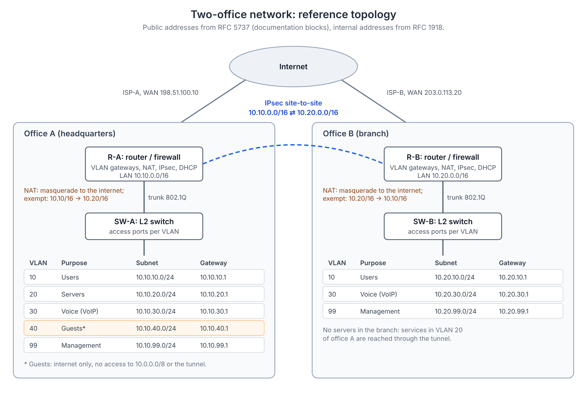

# Two-office network: reference topology

An anonymized, typical topology. Public addresses come from the blocks reserved for documentation
([RFC 5737](https://www.rfc-editor.org/rfc/rfc5737)); internal addresses come from RFC 1918.

## Components

| Element | Office A | Office B |
| --- | --- | --- |
| Router / firewall | VLAN gateways, NAT, IPsec, DHCP | same |
| LAN | 10.10.0.0/16 | 10.20.0.0/16 |
| VLANs | 10 users, 20 servers, 30 voice, 40 guests, 99 management | 10, 30, 99 |
| Inter-office link | IPsec site-to-site 10.10.0.0/16 ⇄ 10.20.0.0/16 | |
| NAT | masquerade to the internet, inter-office traffic exempt | same |

The guest VLAN is isolated: internet access only, no access to 10.0.0.0/8 or the tunnel.
Inter-office traffic must be exempt from NAT; otherwise it leaves through the WAN address and bypasses the tunnel.

## Troubleshooting by layer

| Layer | What to check | Commands (Linux; network devices have equivalents) |
| --- | --- | --- |
| L1-L2 | link state, errors, VLAN on the port | `ip -s link`, `ethtool eth0`, MAC table |
| L3 | address, gateway, route | `ip addr`, `ip route get <address>`, `ping`, `traceroute`, `mtr` |
| Tunnel | IKE/IPsec SA state and counters | SA status on the routers, IKE logs |
| NAT / firewall | whether inter-office traffic gets translated, rule counters | `tcpdump -ni <if> host <address>` on both sides |
| DNS | name resolution | `dig`, `nslookup` |
| MTU | large packets through the tunnel | `ping -M do -s 1400 <address>`, then decrease the size |
