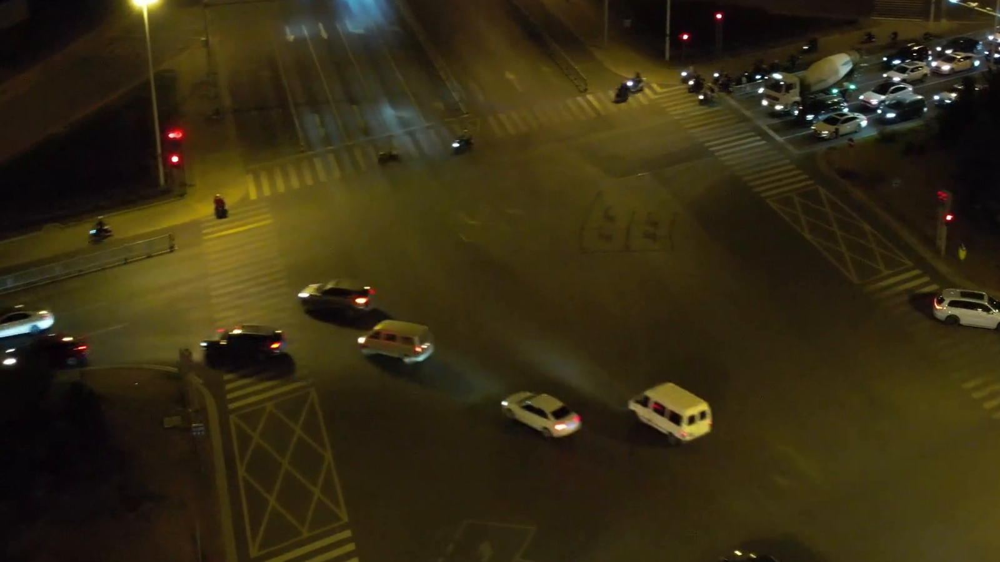

# Red Light Detector

**Computer Vision Prototype for Traffic Signal and Stop-Line Violation Detection**

Red Light Detector is a Python-based computer vision application designed to analyze road intersection images and videos, identify vehicles and traffic signals, estimate stop-line positions, and detect potential red-light violations.

The project combines object detection, image processing, lightweight object tracking, and a web-based interface. It supports both automated analysis and manual configuration for scenarios where visual detection is unreliable.

> **Project status:** Experimental computer vision prototype. Results are intended for demonstration and research purposes, not automated traffic enforcement or legally authoritative conclusions.

## Technology Stack

| Component | Technology |
|---|---|
| Backend | Python, FastAPI |
| Object detection | YOLOv8n, ONNX Runtime |
| Image processing | OpenCV, NumPy |
| Web server | Uvicorn |
| User interface | HTML, Jinja2 |
| Desktop integration | pywebview |
| Analysis history | SQLite |
| Reporting | ReportLab, openpyxl |
| Configuration | Pydantic Settings |

The repository includes a YOLOv8n model in ONNX format at [`models/yolov8n.onnx`](models/yolov8n.onnx).

## Features

- Image and video analysis.
- Vehicle detection using a YOLOv8n ONNX model.
- Traffic signal state estimation.
- Automatic stop-line detection.
- Manual stop-line positioning.
- Configurable fallback when a stop line cannot be detected.
- Basic vehicle tracking across video frames.
- Detection of potential stop-line crossing events.
- Annotated analysis results and evidence frames.
- Local analysis history stored in SQLite.
- PDF and Excel report generation.
- Web interface and optional desktop window.

## How It Works

### 1. Vehicle Detection

The application uses YOLOv8n to detect supported vehicle classes:

- Cars
- Motorcycles
- Buses
- Trucks

Detected objects are represented by bounding boxes, which are used for positioning and tracking.

### 2. Traffic Signal Analysis

The application estimates the current signal state using image processing and color analysis.

When a traffic light is detected, the application analyzes its visual regions to estimate whether the active signal is:

- Red
- Yellow
- Green

Manual signal selection is also available.

For video input, the application applies temporal smoothing to reduce fluctuations between consecutive frames.

Signal recognition depends on lighting, visibility, camera position, and image quality.

### 3. Stop-Line Detection

The application provides three approaches:

| Mode | Description |
|---|---|
| Automatic | Attempts to identify a horizontal stop line using edge and line detection |
| Automatic fallback | Uses a configurable horizontal reference when automatic detection fails |
| Manual | Allows the stop line to be defined using two points |

The default fallback position is 65% of the image height.

**Important:** A fallback reference is a geometric approximation, not confirmation that a real road marking exists at that position.

### 4. Image Analysis

For a single image, the application evaluates the detected vehicle's position relative to the selected stop line and the estimated traffic signal state.

If a vehicle is positioned beyond the line while the signal is red, the application may flag it as a potential violation.

However, a single image cannot establish whether the vehicle crossed the line while the signal was red.

### 5. Video Analysis

For video input, the application processes consecutive frames and uses lightweight tracking to associate vehicle detections over time.

A potential violation is recorded when:

1. A vehicle is tracked across consecutive frames.
2. Its tracked reference point crosses the configured stop line.
3. The estimated traffic signal state is red at the crossing.

The application can retain an evidence frame and timestamp for a detected event.

The tracking approach is intentionally lightweight and may be unreliable during occlusion, abrupt movement, or crowded traffic scenes.

### 6. Results and Reporting

Analysis results can include:

- Number of detected vehicles.
- Number of potential violations.
- Estimated traffic signal state.
- Stop-line position.
- Processing time.
- Annotated images or videos.
- Evidence frames for individual events.

The application stores analysis history locally and supports exporting results to PDF and Excel.

## Sample Media

The repository includes sample media for exploring the analysis workflow.

| Sample | File |
|---|---|
| Intersection video | [intersection_red_light_violation.mp4](demo_media/intersection_red_light_violation.mp4) |
| Video frame | [intersection_red_light_violation_frame.png](demo_media/intersection_red_light_violation_frame.png) |
| Potential violation example 1 | [violation_01.png](demo_media/violation_01.png) |
| Potential violation example 2 | [violation_02.png](demo_media/violation_02.png) |
| Non-violation example 1 | [no_violation_01.png](demo_media/no_violation_01.png) |
| Non-violation example 2 | [no_violation_02.png](demo_media/no_violation_02.png) |

### Example Frame



Sample filenames describe the intended demonstration scenarios. They do not constitute a validated accuracy benchmark.

## Getting Started

### Prerequisites

- Python 3.11 or newer.
- pip.
- A local environment capable of running OpenCV and ONNX Runtime.

### 1. Open the Project Directory

From the root of the DevOps Portfolio repository:

```bash
cd projects/red-light-detector
```

### 2. Create a Virtual Environment

```bash
python -m venv .venv
```

Activate it on Linux or macOS:

```bash
source .venv/bin/activate
```

On Windows PowerShell:

```powershell
.venv\Scripts\Activate.ps1
```

### 3. Install Dependencies

```bash
python -m pip install -r requirements.txt
```

### 4. Start the Web Application

```bash
python -m uvicorn app.main:app --host 127.0.0.1 --port 8000
```

Open:

**http://localhost:8000**

To check the backend health endpoint:

```bash
curl http://localhost:8000/api/health
```

Expected response:

```json
{
  "status": "ok"
}
```

### Windows Launcher

The repository also includes [`run.bat`](run.bat) for starting the web application on Windows.

### Desktop Mode

To launch the application in a desktop window:

```bash
python desktop.py
```

Desktop mode uses pywebview to display the locally hosted application.

## Configuration

The example configuration is available in [`.env.example`](.env.example).

| Variable | Default | Purpose |
|---|---|---|
| `APP_NAME` | Russian application title | Application name |
| `MODEL_PATH` | `models/yolov8n.onnx` | ONNX model location |
| `CONFIDENCE` | `0.35` | Object detection confidence threshold |
| `IOU_THRESHOLD` | `0.45` | Intersection-over-Union threshold |
| `MAX_UPLOAD_MB` | `500` | Maximum uploaded media size in MB |
| `DEFAULT_STOP_LINE_Y` | `0.65` | Default stop-line vertical position |
| `TRAFFIC_LIGHT_SMOOTHING` | `5` | Temporal smoothing window |

The reference configuration can be copied and adjusted for the local environment.

## API Endpoints

| Method | Endpoint | Purpose |
|---|---|---|
| `GET` | `/` | Web interface |
| `GET` | `/api/health` | Health check |
| `POST` | `/api/analyze` | Submit an image or video for analysis |
| `GET` | `/api/history` | Retrieve analysis history |
| `GET` | `/api/history/{aid}` | Retrieve a specific analysis |
| `GET` | `/api/history/{aid}/report.pdf` | Download a PDF report |
| `GET` | `/api/history/{aid}/report.xlsx` | Download an Excel report |

### Supported Media

**Images:**

- JPEG
- PNG
- BMP
- WebP

**Videos:**

- MP4
- AVI
- MOV
- MKV
- WebM
- M4V

Video processing depends on the codecs supported by the local OpenCV installation.

## Project Structure

```text
projects/red-light-detector/
├── app/
│   ├── main.py
│   └── ...
├── demo_media/
│   ├── intersection_red_light_violation.mp4
│   ├── intersection_red_light_violation_frame.png
│   ├── violation_01.png
│   └── ...
├── models/
│   └── yolov8n.onnx
├── .env.example
├── desktop.py
├── requirements.txt
├── run.bat
└── README.md
```

Runtime analysis history and generated output files are stored locally.

## Known Limitations

This project demonstrates a computer vision workflow rather than a production-ready traffic enforcement system.

Key limitations include:

1. **Traffic signal recognition:** Color-based analysis can be affected by reflections, glare, nighttime conditions, and unusual traffic-light configurations.
2. **Object detection:** Vehicles may be missed or incorrectly classified, especially when partially obscured.
3. **Stop-line estimation:** Automatic detection can fail, while the fallback position is only an approximation.
4. **Single-image analysis:** A photograph cannot establish the timing or direction of vehicle movement.
5. **Object tracking:** Lightweight tracking may lose vehicle identity across frames.
6. **Camera perspective:** A vehicle's image-space position does not always represent its exact position on the road.
7. **Accuracy evaluation:** No independently validated precision, recall, or real-world enforcement performance metrics are provided.

Detected events should therefore be treated as **potential violations requiring human review**.

## Project Background

Red Light Detector was developed as an academic computer vision project and serves as a practical demonstration of Python backend development, object detection, image processing, video analysis, and reporting.

The project is included in a broader technical portfolio covering DevOps, infrastructure automation, CI/CD, containerization, and software engineering.

## Portfolio

[Back to DevOps Portfolio](../../README.md)
